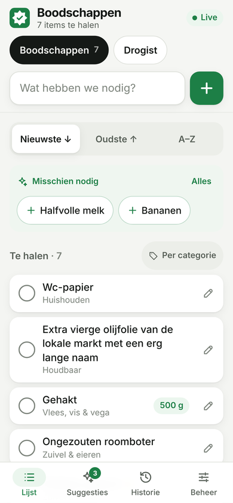
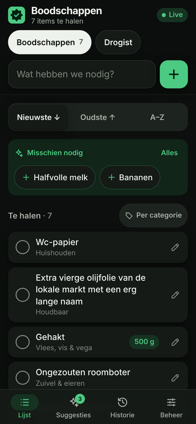
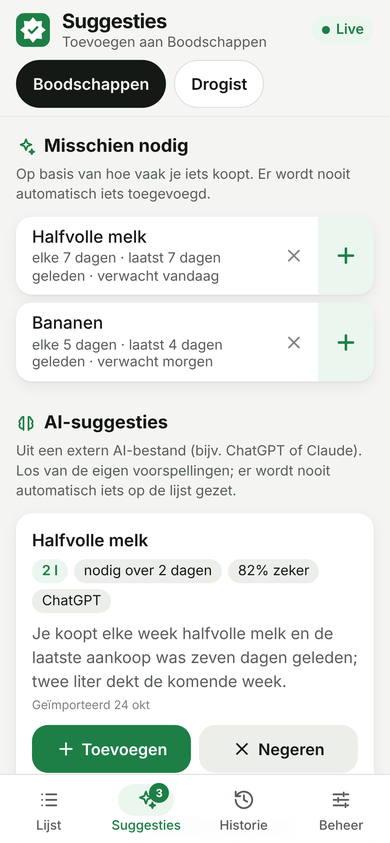
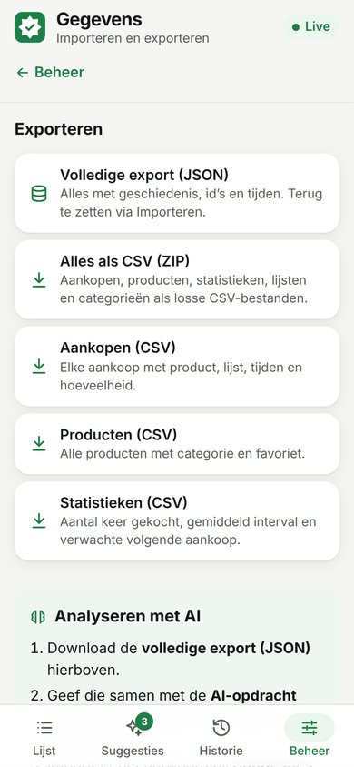
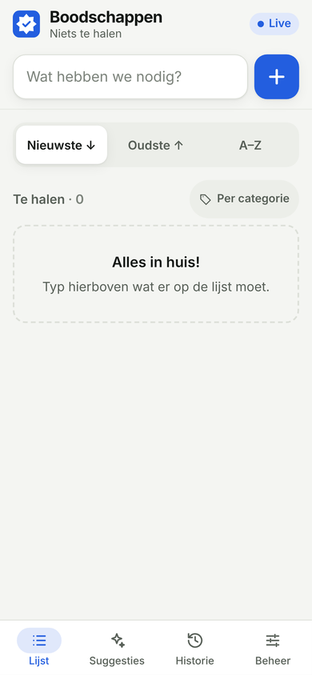

# 8star Grocery List

A self-hosted, offline-first grocery list for the whole household. It's a Progressive Web App
built for Android phones, syncs in realtime between devices and runs as a single Docker
container on your private network or VPN. No accounts, no cloud services, no telemetry.

The UI is in Dutch; code and documentation are in English.

<p>
  
  
  
  
  
</p>

## Features

**Shopping list**

- Large “Wat hebben we nodig?” input. Add with Enter or the + button. Focus stays in the field
  for fast consecutive entry.
- Quantities and units are understood while typing: `2 melk`, `500 g gehakt`,
  `1,5 kg aardappelen`, `eieren x10`.
- Live autocomplete from every product you ever added, ranked by frequency, recency and favourites.
- Duplicates are prevented, ignoring case and whitespace (` HALFVOLLE   melk` = `Halfvolle melk`).
- Tap a row to tick it off. Completed items turn grey and move into a collapsible section. Tap
  again to put an item back on the list; it then counts as newly added.
- Always-visible sort control: **Nieuwste ↓ · Oudste ↑ · A–Z** (Dutch collation). The choice is
  remembered per device.
- Optional grouping by category, in a category order you set (e.g. the walking route of your
  supermarket).
- Edit name, quantity (stepper), unit (chips), category, favourite and list in one bottom sheet.
- Delete with confirmation. Quick **Ongedaan maken** (undo) for tick-off, put-back, delete, move
  and clearing, without ever counting a purchase wrongly.
- Multiple independent lists (e.g. Supermarkt, Drogist, Markt). Move items between lists.

**History and suggestions**

- Every activation and purchase cycle is stored, so the full history is preserved.
- Per product: first added, times bought, last bought, average interval, frequency per month and
  estimated next purchase.
- **Misschien nodig**: local predictions once a product has at least 3 purchases. Never added
  automatically. One tap adds a suggestion; “Niet nu” hides it for a while.
- Favourites, frequently bought products, searchable product history and purchase timeline.

**Import, export and external AI** (Beheer → Gegevens)

- Versioned, complete JSON export with stable ids and ISO 8601 timestamps. Restore it fully
  (**Alles vervangen**, with an automatic pre-import backup and confirmation) or **merge** it into
  existing data.
- CSV export of purchases, products and statistics, or everything as a ZIP. CSV import of
  products and purchase history.
- Every import shows a preview first, validates the whole file, detects duplicates, runs in one
  transaction and reports the result in plain Dutch. See [docs/IMPORT-EXPORT.md](docs/IMPORT-EXPORT.md).
- **AI-suggesties**: analyse your export with ChatGPT, Claude or Python and import the result.
  Suggestions are shown separately from the local predictions, accepted or dismissed with one
  tap, and never touch the list or history by themselves. See
  [docs/AI-RECOMMENDATIONS.md](docs/AI-RECOMMENDATIONS.md).

**One accent color for the whole app**

- `APP_PRIMARY_COLOR` in Docker Compose/Dockhand (e.g. `"#2563EB"`) restyles buttons, sort control,
  navigation, focus rings, suggestions, the PWA manifest and the app icons. It is applied at
  runtime, so recreating the container is enough. Accessible light and dark variants are derived
  automatically; warning and error colors stay as they are.

**Sync and offline**

- Realtime updates on every device via Server-Sent Events.
- Works fully offline. Changes are queued durably in IndexedDB and synced automatically when the
  network or VPN returns.
- Idempotent operations with unique ids, server-side duplicate merging, field-level
  last-writer-wins with user notification, and a visible sync log, so no data is lost silently.
  See [docs/SYNC.md](docs/SYNC.md).

**PWA and mobile UX**

- Installable on Android, standalone display, maskable icons, offline app start, service worker
  update prompt.
- Portrait-first one-thumb layout. Touch targets are ≥ 48 × 48 px. No dropdowns, no hamburger menu,
  bottom navigation.
- Respects safe areas and gesture navigation. The Android back gesture closes sheets.
- The layout stays usable with the keyboard open; the bottom navigation steps aside while typing.
- Automatic light/dark mode, subtle animations, `prefers-reduced-motion` support. Survives large
  system font sizes (tested at 160 %) and narrow screens down to 320 px.

## Architecture

```
┌──────────── Android / browser (PWA) ────────────┐        ┌───────── Docker container ─────────┐
│ Svelte 5 UI ── app state ── SyncEngine          │  HTTP  │ SvelteKit (adapter-node)           │
│                    │  optimistic reducer        │ ─────▶ │  POST /api/ops   (idempotent ops)  │
│                    │  IndexedDB: snapshot+queue │ ◀───── │  GET  /api/snapshot                │
│ Service worker: cached app shell                │  SSE   │  GET  /api/events (change seq)     │
└─────────────────────────────────────────────────┘ ◀───── │ GroceryStore ── SQLite (WAL) /data │
                                                           └────────────────────────────────────┘
```

- **SvelteKit 2 + Svelte 5 + TypeScript + Tailwind CSS 4**, built with `adapter-node`. The UI is
  a client-rendered app shell (`ssr = false`), so one cached shell serves every route offline.
- **SQLite** via `better-sqlite3`: WAL mode, foreign keys, versioned migrations
  (`PRAGMA user_version`) that run automatically at startup, and a pre-migration backup.
- **Shared domain code** (`src/lib/shared`) is used by both server and client: op validation,
  statistics, sorting, autocomplete and the optimistic reducer.
- Lightweight on purpose: one container, one SQLite file, no external services.

```
src/
  lib/shared/     types, ops protocol, reducer, statistics, selectors, text/quantity parsing
  lib/server/     db + migrations, GroceryStore (op handlers, undo, history), SSE hub, backups
  lib/client/     SyncEngine, IndexedDB, app state, PWA, toasts, modal history handling
  lib/components/ UI components (rows, sheets, sort control, navigation…)
  routes/         / (Lijst), /suggesties, /historie, /beheer, /api/*
  service-worker.ts
tests/            Vitest unit + integration (store, imports, sync engine, backups, release script)
e2e/              Playwright: CRUD, lists, history, sync, offline, imports, AI, theme, PWA, layout
```

### Data model

| Table                | Purpose                                                                           |
| -------------------- | --------------------------------------------------------------------------------- |
| `lists`              | Shopping lists with order                                                         |
| `categories`         | Categories with configurable order (Dutch defaults seeded)                        |
| `products`           | Unique products (`name_key` = lower-cased, whitespace-collapsed), favourite flag  |
| `items`              | A product on a list: status, quantity, unit, `activated_at`, `completed_at`       |
| `cycles`             | Every activation → purchase (`completed_at`) or cancellation: the full history    |
| `ops`                | Applied operations (idempotency + undo inverse), pruned after 90 days             |
| `id_aliases`         | Client ids merged into existing entities (concurrent duplicate adds)              |
| `ai_recommendations` | Imported external AI suggestions (open/accepted/dismissed), separate from history |
| `meta`               | Global change sequence and data epoch                                             |

## Development

Requirements: Node.js 22.

```sh
npm install
npm run dev              # http://localhost:5173 (data in ./data)
npm run check            # svelte-check / TypeScript
npm run lint             # Prettier + ESLint
npm run test:unit        # Vitest unit + integration tests
npm run build            # production build into ./build
npm run test:e2e         # Playwright against the production build (run build first)
npm run test:all         # everything above
```

Playwright starts the built server on port 4173 with a throw-away data directory and
`E2E_TEST_MODE=1`, which enables a reset endpoint that returns 404 in normal deployments. Mobile
layout screenshots are written to `screenshots/` (in CI they are uploaded as the
`mobile-screenshots` artifact).

## Deployment

The full guide is in **[docs/DOCKHAND.md](docs/DOCKHAND.md)**: Dockhand setup, HTTPS options,
updating, backups, restore and troubleshooting.

Quick start with plain Docker Compose:

```sh
cp .env.example .env        # set BIND_ADDRESS to the server's LAN/VPN IP
docker compose up -d --build
curl http://<BIND_ADDRESS>:3000/api/health
```

- Multi-stage image on `node:22-bookworm-slim`, running as the unprivileged `node` user (uid 1000)
  with a read-only root filesystem, all capabilities dropped and `no-new-privileges`.
- SQLite lives in the named volume `8star-grocery-data` (`/data`), with automatic backups in
  `/data/backups`.
- Healthcheck on `/api/health`, `restart: unless-stopped`, graceful shutdown with a WAL
  checkpoint.
- The port is bound to `BIND_ADDRESS` (default `127.0.0.1`), never to a public interface.

### Configuration

| Variable                              | Default                                      | Description                                   |
| ------------------------------------- | -------------------------------------------- | --------------------------------------------- |
| `BIND_ADDRESS`                        | `127.0.0.1`                                  | Host interface to publish on (LAN/VPN IP)     |
| `HOST_PORT`                           | `3000`                                       | Host port                                     |
| `ORIGIN`                              | –                                            | Public URL when behind an HTTPS reverse proxy |
| `PROTOCOL_HEADER`                     | –                                            | e.g. `x-forwarded-proto` behind a proxy       |
| `HOST_HEADER`                         | –                                            | e.g. `x-forwarded-host` behind a proxy        |
| `APP_PRIMARY_COLOR`                   | `#1D7F46`                                    | Accent color (six-digit hex), runtime         |
| `TZ`                                  | `Europe/Amsterdam`                           | Time zone                                     |
| `BACKUP_INTERVAL_HOURS`               | `24`                                         | Automatic backup interval, `0` disables       |
| `BACKUP_KEEP`                         | `14`                                         | Number of automatic backups to keep           |
| `DATA_VOLUME`                         | `8star-grocery-data`                         | Docker volume name                            |
| `DATA_DIR` / `DB_PATH` / `BACKUP_DIR` | `/data`, `/data/grocery.db`, `/data/backups` | Paths inside the container                    |

### Backups and restore

```sh
docker compose exec app node scripts/backup.mjs              # consistent online backup
sh scripts/restore.sh --list                                 # available backups
sh scripts/restore.sh grocery-2026-10-24_03-00-00-auto.db    # stop, verify, swap, start
```

Details and the manual procedure are in [docs/DOCKHAND.md](docs/DOCKHAND.md#9-backups-restore-and-data-import).

### HTTPS

Android requires HTTPS to install the app and to start it offline. Over plain HTTP on a LAN IP,
the shared list and realtime sync work, but installation and offline start don't. The easiest
private option is `tailscale serve`. See [docs/DOCKHAND.md](docs/DOCKHAND.md#5-https-needed-for-installing-and-offline-start).

## Releases

Releases are published from the terminal with `bash scripts/release.sh vX.Y.Z` after the release
PR is merged and CI is green; deployment in Dockhand is a separate step. See
[docs/RELEASE.md](docs/RELEASE.md).

## Security model

This app has no authentication by design. Anyone who can reach it can read and change the lists.
Keep it reachable only on your private network or VPN: bind to a LAN/VPN address, add no router
port forwards and no public tunnels. The server validates every operation, sets strict security
headers including a hash-based CSP, and never contacts external services.

## Testing status

See [CHANGELOG.md](CHANGELOG.md) for what is covered. Mobile behaviour was verified with
Playwright's Chromium device emulation at 320/360/390/430/412 px in portrait and landscape,
light and dark, at 130 % and 160 % font scale, and with a simulated keyboard-open viewport. It
was **not** tested on a physical Samsung Galaxy A57 or Google Pixel 10.

## License

Private project. All rights reserved.
